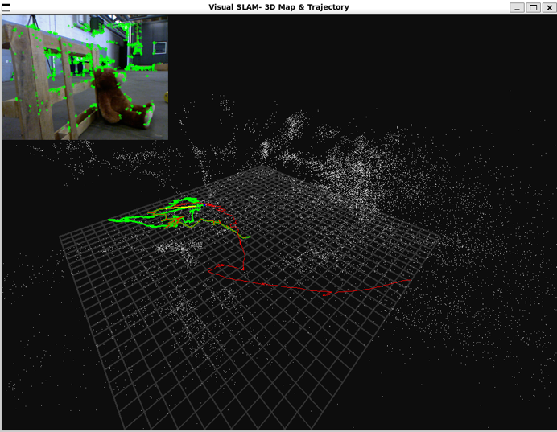
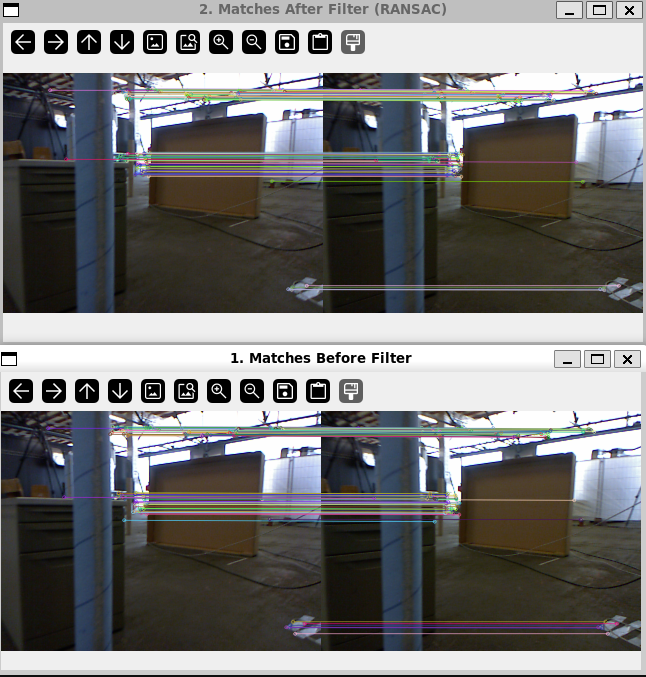
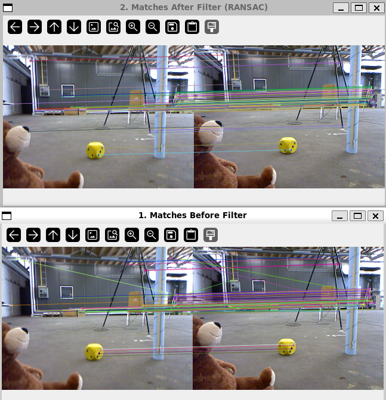
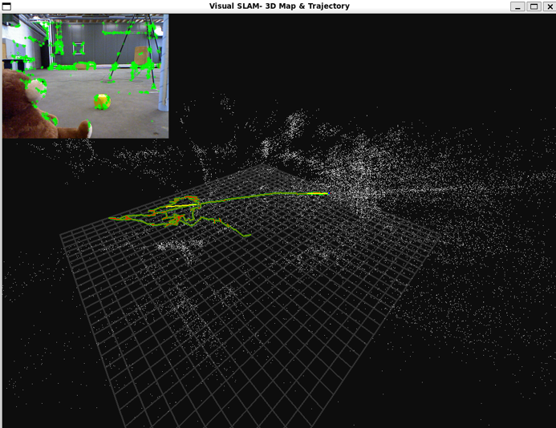
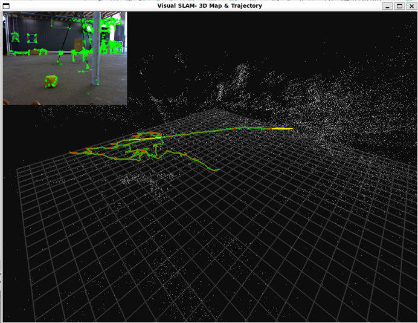

# Drone Visual SLAM (Monocular)

A monocular Visual SLAM system written in Python. It takes an image sequence recorded by a drone and, frame by frame, estimates where the camera is, builds a 3D point cloud of the scene, and corrects accumulated drift when the drone returns to a place it has already seen. Everything is shown live in a Pangolin 3D viewer.

I built this as part of the *Navigation, Mapping and Localization Algorithms* course (Visual Odometry and 3D Reconstruction – SLAM exercise). Most of the core geometry is implemented by hand, using the equations from the course (triangulation, epipolar error, reprojection error, Kalman filter), with OpenCV used for feature detection, the essential matrix and PnP.

<p align="center">
  
  <br>
  <em>The 3D point cloud and the estimated trajectory right after a loop closure. Red is the trajectory before the correction, green is the corrected one.</em>
</p>

---

## What the system does

For each new image the pipeline runs these steps:

1. **Feature extraction and matching.** ORB features are extracted and matched to the reference frame with a brute-force Hamming matcher (cross-check on).
2. **Outlier filtering.** RANSAC on the essential matrix removes bad matches. The matches before and after filtering are shown in two OpenCV windows.
3. **Epipolar error.** The mean point-to-epipolar-line distance is printed for all descriptor matches and again for only the RANSAC inliers, so you can see how much the geometric filter cleans up.
4. **Relative motion.** `recoverPose` gives the rotation and translation direction between the reference frame and the current frame.
5. **Triangulation.** New 3D points are computed with my own linear (DLT/SVD) triangulation, `A·X = 0`, and only points in front of the camera are kept.
6. **Pose refinement.** The pose is refined with Levenberg–Marquardt (`scipy.optimize.least_squares`) by minimizing the reprojection error. The error before and after optimization is printed.
7. **EKF fusion.** The visual measurement goes into an Extended Kalman Filter that smooths the trajectory and keeps predicting motion between measurements.
8. **PnP re-localization.** Every 10 frames the pose is re-estimated with `solvePnPRansac` against 3D points already in the map.
9. **Loop closure.** The current frame is compared to old frames. When a revisit is found and verified geometrically, the accumulated drift is spread back over the loop.
10. **Visualization.** Trajectory, map, loop closures and the live camera image are drawn in Pangolin.

---

## Screenshots

### Feature matching before and after RANSAC
In each image, the bottom window shows all descriptor matches and the top window shows only the matches that survive the RANSAC filter on the essential matrix. The diagonal lines below (wrong matches) disappear once the filter is applied.

<p align="center">
  
  
</p>

### Trajectory and map while running
The live camera image with ORB keypoints is in the top-left corner. The gray points are the triangulated 3D map, and the green line is the trajectory estimated by visual odometry + EKF.

<p align="center">
  
  
</p>

---

## Main ideas and design decisions

### Reference frame and parallax
Consecutive drone frames are very close to each other, often only a few pixels apart. With such a small baseline the essential matrix still works, but the translation *direction* is mostly noise, and the trajectory ends up jumping back and forth.

To avoid that, I don't always compare to the previous frame. I keep a **reference frame** (the last frame with a good pose) and only estimate a new pose once the **median pixel displacement** to it is above `MIN_PARALLAX_PX` (15 px). Frames below the threshold are marked `waiting`, and the EKF predicts their position.

### Extended Kalman Filter
State vector (7 values):

```
x = [x, y, z, yaw, vx, vy, vz]^T
```

- **Predict:** constant-velocity model, `p_new = p_old + v·dt`.
- **Update:** the measurement is the absolute position from visual odometry (plus yaw), so `H` picks `x, y, z, yaw` directly. Velocity is never measured. The filter infers it through the motion model and the covariance.
- **Frames without a measurement** (`waiting` or tracking lost) only run `predict`, so the drone keeps moving smoothly instead of standing still and then jumping.
- **Velocity damping:** each frame without a measurement multiplies the velocity by `VEL_DECAY` (0.95), a soft zero-velocity update. Without it, the filter keeps "flying" with an old velocity when the drone actually stops.

### Scale
A single camera can't recover absolute scale: `recoverPose` always returns a unit-length translation. I use a fixed scale factor (`scale=5.0` in `main`), and the **same scale is applied to the triangulated points**. That keeps the map and the trajectory consistent with each other, which matters for PnP and loop closure.

### PnP re-localization
Every 10 frames the pose is computed again from 2D–3D correspondences with `solvePnPRansac`. The PnP step runs *before* the current pair's new points are added to the map. Otherwise it would localize against points that were just triangulated from the same two frames, which is circular and adds no new information.

### Loop closure
- **Candidates:** every 3rd successfully tracked frame is stored as a loop candidate.
- **Detection:** every 5 successful frames, the current frame is matched against candidates that are at least `LC_MIN_GAP` (150) frames older. The candidate with the most good descriptor matches (Hamming distance < 50) is selected if it has at least 150 of them.
- **Geometric verification:** PnP against the candidate's 3D points must give at least `LC_MIN_INLIERS` (40) inliers. This step stops scenes that only *look* similar from being accepted.
- **Correction:** the PnP result says where the drone is according to the *old* map. The difference from the current estimate is the accumulated drift. It is spread linearly over all frames in the loop (0 at the old frame, the full drift at the current one), and map points are shifted the same way. This is a simplified, translation-only version of pose-graph optimization.
- **Visualization:** the trajectory before correction is kept and drawn in red, and the loop link is drawn in yellow, so the effect of the closure is visible (see the image at the top of this page).

A note on `LC_MIN_GAP`: with a small gap (around 50 frames) the drone still sees the same scene a few seconds later, so the system keeps "closing" short loops that are really just re-localizations. A larger gap makes it detect only real revisits.

### Camera intrinsics
No calibration is available for the dataset, so the intrinsic matrix is built from the image size (as the exercise allows):

```
K = [[w, 0, w/2],
     [0, w, h/2],
     [0, 0,  1 ]]
```

### Coordinate system
Internally everything is in the OpenCV camera convention: X right, Y down, Z forward. For drawing in OpenGL, points are shown as `(x, -y, -z)`. That is a 180° rotation about X, so "up" is drawn up and the scene isn't mirrored (flipping only Y would mirror it).

---

## Code structure

Everything is in `drone_VSLAM.py`:

| Class / function | Role |
|---|---|
| `Frame` | A single image: keypoints, descriptors, id, 4×4 pose (`RotationMatrix`, `TranslationVector`), timestamp, processed flag, and a map from keypoint index to 3D point |
| `Point` | A 3D map point in global coordinates plus the ids of the frames that see it |
| `Map` | List of all 3D points and all frames |
| `DroneEKF` | Extended Kalman Filter (`predict` / `update`) |
| `VisualOdometry` | The SLAM pipeline: matching, essential matrix, triangulation, LM refinement, EKF fusion, PnP, loop closure |
| `calculate_epipolar_error` | Mean distance from points to their epipolar lines, `x'ᵀ F x = 0` |
| `PangolinVisualizer` | 3D viewer: grid, point cloud, trajectory, camera axes, loop closure, live image |

Pose convention: `frame.pose` is camera-to-world, so `TranslationVector` is the camera center in world coordinates.

---

## Requirements

- Python 3.12 (tested on Ubuntu under WSL2 with WSLg for the windows)
- `numpy`
- `opencv-python`
- `scipy`
- `PyOpenGL`
- `pypangolin`, the Python bindings of [Pangolin](https://github.com/stevenlovegrove/Pangolin), built from source

```bash
pip install numpy opencv-python scipy PyOpenGL
```

### Installing Pangolin (with Python bindings)

`pypangolin` isn't on PyPI, so it has to be built from source. This is what I did on Ubuntu (WSL2):

```bash
# 1. Clone with submodules
git clone --recursive https://github.com/stevenlovegrove/Pangolin.git
cd Pangolin

# 2. Install system dependencies (OpenGL, GLEW, Eigen, etc.)
./scripts/install_prerequisites.sh recommended

# 3. Configure and build
cmake -B build
cmake --build build

# 4. Build and pip-install the Python bindings
cmake --build build -t pypangolin_pip_install
```

Check that it worked:

```bash
python3 -c "import pypangolin; print(pypangolin.__file__)"
```

A few things I ran into:

- **Python version.** The bindings are built for the Python that CMake finds. If you use a virtual environment, activate it *before* step 3, so `pypangolin` is built for that interpreter.
- **Run it from Linux, not Windows.** If the project lives in WSL, run the script from a WSL terminal (or from VS Code connected to WSL). Windows Python can't load the Linux `pypangolin` `.so`.
- **Display.** On WSL2 the windows open through WSLg. The warning `libEGL warning: DRI3 error` only means there is no GPU acceleration and can be ignored. The same goes for the `QFontDatabase` warnings from the OpenCV windows.

---

## Dataset

The dataset (`Dataset_VO`, about 1.2 GB of PNG images taken by a drone) is **not included** in this repository because of its size. Put the images in a folder named `Dataset_VO` next to the script:

```
VSLAM_PROJECT/
├── drone_VSLAM.py
└── Dataset_VO/
    ├── 1311877977.077520.png
    ├── 1311877977.113269.png
    └── ...
```

Images are read in sorted (chronological) order.

---

## Running

```bash
python3 drone_VSLAM.py
```

Three windows open:

- **Visual SLAM – 3D Map & Trajectory** (Pangolin)
  - gray: 3D point cloud
  - green: current trajectory
  - red: trajectory before the last loop closure correction
  - yellow: loop closure link between the two matched frames
  - red/green/blue axes: current camera orientation
  - top-left corner: live image with ORB keypoints
- **1. Matches Before Filter**: raw descriptor matches
- **2. Matches After Filter (RANSAC)**: inliers only

When the sequence ends, the 3D viewer stays open until you close it.

### Reading the console output

```
Frame  18 | Epipolar Error -> Before filter: 1.8885 (1191 matches) | After RANSAC: 0.4542 (1045 inliers)
   [LM] Reprojection Error -> Before: 0.1399 | After: 0.1389
   EKF Pos: [-4.06, -1.14, 0.42]
Frame  19 | low parallax (3.6px) vs ref 18 - waiting | pred pos [-4.11, -1.15, 0.42]
   *** PnP Re-Localization Successful | Inliers: 517 ***
   <<< LOOP CLOSURE DETECTED >>> with Frame 242 | PnP inliers: 44
   Loop correction | drift: 110.47 over 373 frames
```

- **Epipolar Error:** before the RANSAC filter it is usually 1–7 px. After it, it stays around 0.4–0.7 px, below the 1 px RANSAC threshold.
- **LM Reprojection Error:** before and after the Levenberg–Marquardt refinement.
- **waiting:** not enough parallax yet, so the EKF only predicts.
- **TRACKING LOST - FALLBACK:** usually *not* a matching failure. The essential matrix is fine, but `recoverPose` rejects most points as too far away (more than 50 baselines), so the frame is handled with EKF prediction only.

---

## Settings

All tunable values are at the top of the script:

| Setting | Default | Meaning |
|---|---|---|
| `MIN_TRUST_INLIERS` | 30 | Minimum `recoverPose` inliers to accept a pose |
| `MIN_PARALLAX_PX` | 15.0 | Median pixel displacement needed before estimating a new pose |
| `VEL_DECAY` | 0.95 | EKF velocity damping per frame without a measurement |
| `LC_CHECK_EVERY` | 5 | Look for a loop every N successful frames |
| `LC_MIN_GAP` | 150 | Minimum age (in frames) of a loop candidate |
| `LC_MATCH_DIST` | 50 | Max Hamming distance for a "good" match |
| `LC_MIN_MATCHES` | 150 | Minimum good matches to consider a candidate |
| `LC_MIN_INLIERS` | 40 | Minimum PnP inliers to accept a loop |

EKF noise (in `DroneEKF.__init__`): `Q = 0.01·I`, `R = 0.05·I`. I tried a higher process noise for the velocity, but it made the trajectory overshoot after long gaps without measurements, so I kept the original values.

---

## Known limitations

- **Scale is fixed, not estimated.** Like any monocular system, the trajectory is only correct up to scale, and the scale can drift between segments.
- **Loop correction is translation-only.** Rotation drift isn't corrected, and there is no full pose-graph or bundle adjustment.
- **Yaw in the EKF** is taken as `atan2(R[1,0], R[0,0])`, which in the camera frame is actually a rotation about the optical axis. It doesn't affect the drawn pose (that comes from the rotation matrix), but it isn't a true yaw.
- **The reprojection error is optimistic.** It is measured on the same observations the points were triangulated from, so it is always small.
- **Fast rotations** (low inlier ratio, high epipolar error before filtering) are the hardest parts of the sequence. There the system mostly relies on EKF prediction.
- **The intrinsics are an approximation** built from the image size, without lens distortion.
